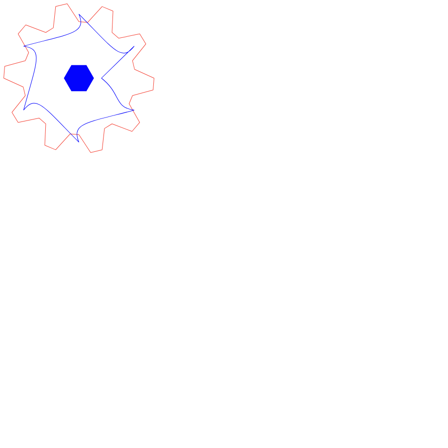
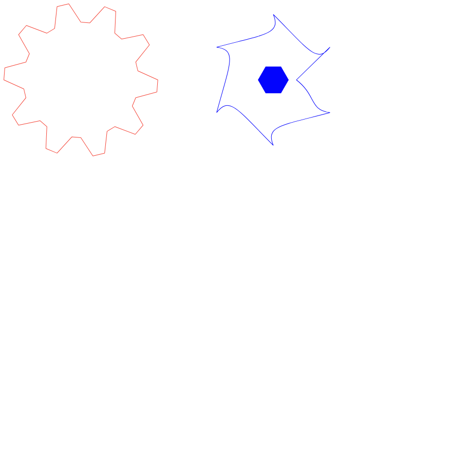

<div align="center">

# ⚡ lac2svg

**Convert [Bambu Studio](https://bambulab.com/download/studio) laser project files (`.lac`) to SVG — losslessly.**

[](https://lac-to-svg.lovable.app)
[](https://www.python.org)
[](LICENSE)
[](#-testing)

[Website](https://lac-to-svg.lovable.app) ·
[How it works](#-how-it-works) ·
[Usage](#-usage) ·
[File format](docs/FORMAT.md)

</div>

---

Bambu Studio saves 2D laser projects as `.lac` files — a ZIP package whose
vector geometry lives in a JSON scene graph. If you want that artwork in
Inkscape, Illustrator, a vinyl cutter, or any CAD tool, you're stuck: the
Suite only exports SVG through its own (limited) pipeline.

**lac2svg** reads `.lac` files and writes clean, standards-compliant SVG with
the **exact same geometry** Bambu Studio exports — verified path-by-path
against the Suite's own SVG export: **34/34 paths identical, max deviation
0.0004 mm**.

| Design canvas (`--layout design`) | Making plate (`--layout plate`) |
|:---:|:---:|
|  |  |

*(example project: [`examples/gear-flower.lac`](examples/gear-flower.lac) — original artwork, CC0)*

## ✨ Features

- 🎯 **Pixel-perfect geometry** — matches Bambu Studio's own SVG export (verified to 0.0004 mm)
- 🗂 **Both layouts** — the 2D design canvas *and* the auto-arranged making plate
- 🧠 **Full scene graph** — nested groups, transforms (rotate/scale/translate) baked into absolute coordinates
- 🎨 **Process-aware styling** — cuts get outlines, fill engravings get fills; each path carries `data-process` (`LaserLineCut`, `LaserLineEngrave`, `LaserFillEngrave`)
- 🖊 **Studio-identical strokes** — 1 px non-scaling stroke, square caps, bevel joins, exactly like the Suite renders
- 📏 **Real units** — `width`/`height` in millimeters, correct `viewBox`, configurable margin
- 🏷 **Metadata preserved** — object names as `inkscape:label`, project title as `<title>`
- 📦 **Zero dependencies** — pure Python standard library, single file
- 🔒 **100% offline** — your designs never leave your machine

## 🚀 Usage

```bash
# Basic conversion (design canvas)
python lac2svg.py project.lac

# Explicit output file
python lac2svg.py project.lac output.svg

# Making-plate arrangement (as it will be cut)
python lac2svg.py project.lac output.svg --layout plate

# Stroke width in mm (default 0 = Studio look: constant 1px on screen)
python lac2svg.py project.lac output.svg --stroke-width 0.3

# viewBox margin in mm (default 2)
python lac2svg.py project.lac output.svg --margin 5
```

| Option | Default | Description |
|---|---|---|
| `input` | — | `.lac` file (required) |
| `output` | `<input>.svg` | Output path; multi-canvas projects get `_canvas1.svg`, `_canvas2.svg`, … suffixes |
| `--layout` | `design` | `design` = 2D canvas arrangement · `plate` = making-plate arrangement from project settings |
| `--stroke-width` | `0` | Stroke width in mm. `0` = Bambu Studio look (1 px constant on screen, `vector-effect="non-scaling-stroke"`) |
| `--margin` | `2` | Extra space around the artwork in the `viewBox`, in mm |

> **No Python? No problem.** Try the web version — 100% client-side, nothing is uploaded:
> **[lac-to-svg.lovable.app](https://lac-to-svg.lovable.app)**

## 🧠 How it works

A `.lac` file is an OPC package (ZIP) containing JSON:

```
project.lac (ZIP)
├── [Content_Types].xml
├── _rels/.rels
├── 2D/
│   ├── entry.json              ← project metadata (Title, …)
│   ├── 2dmodel.json            ← the scene graph (canvases → objects)
│   └── design_thumbnail.png
└── Metadata2D/
    └── project_settings.json   ← process types, making plates, materials
```

The converter:

1. **Unpacks** the ZIP and parses `2dmodel.json` (scene graph) and `project_settings.json` (process types).
2. **Normalizes** path data — `.lac` stores cubic Beziers as `C end c1 c2` (endpoint *first*!), which it reorders to SVG's `C c1 c2 end`.
3. **Bakes transforms** — walks the scene graph (canvases → groups → paths), composing SVG-style matrices and rewriting every path in absolute coordinates.
4. **Styles** each path by its process type and computes a tight `viewBox` from the actual geometry.

Full reverse-engineered format documentation: **[docs/FORMAT.md](docs/FORMAT.md)**

## 📦 Installation

No install needed — it's a single file with **zero dependencies**:

```bash
git clone https://github.com/EdysonAcioli/lac2svg.git
cd lac2svg
python lac2svg.py --help
```

Requires Python 3.8+ (standard library only).

## 🧪 Testing

```bash
python -m pytest tests/ -v
```

33 tests cover the transform math, the `.lac` Bezier reordering, path baking,
styling, and end-to-end CLI conversion of the bundled example.

## 🤝 Contributing

Issues and PRs are welcome! If you have a `.lac` file that converts
incorrectly, please open an issue describing what you see in Bambu Studio
vs. the SVG output.

## 📄 License

[MIT](LICENSE) — the converter and the bundled example are free for any use.
